# Super Dolores

Práctica 13: ejercicio guiado de TDD (desarrollo guiado por pruebas) con Flutter. Una SuperApp con mensajería, pagos, comercio y transporte en un solo ecosistema.

- Alumno: Oscar Manuel Ayala Ortiz
- N.C. 1225100784, grupo GTID244
- Materia: Desarrollo de Aplicaciones Móviles
- Docente: Anastacio Rodríguez García

## Qué es

Una sola app donde conviven varios servicios de Dolores Hidalgo: chat, monedero, tienda de negocios locales y viajes. Todos usan el mismo monedero y la misma cuenta. Se puede cambiar de persona (Ana, Luis, Marta) para ver las dos puntas de una conversación o de una transferencia.

El dinero es de práctica y siempre se guarda en **centavos enteros**, nunca en `double` (`0.1 + 0.2` no da `0.3`). No se usa ningún paquete externo: todo el dominio es Dart puro y los servicios son simulados.

## Las cuatro ideas de diseño

- **Un monedero para todo:** con él se paga el viaje, la compra y lo que le mandas a un amigo. Funciona como contabilidad (un libro de movimientos), no como un número suelto.
- **Eventos en lugar de llamadas directas:** cuando Comercio crea un pedido solo anuncia el evento, y a quien le interese (Lealtad, Notificaciones, Analítica) reacciona. Agregar un servicio nuevo no obliga a tocar los demás.
- **Mini-apps con permisos mínimos:** cada mini-app declara qué permisos necesita y la plataforma revisa esos permisos en cada llamada. Un horóscopo de un tercero no puede leer tu saldo ni tus chats.
- **Kill switch:** si un servicio falla se puede apagar; la app lo oculta y bloquea sus llamadas.

La plataforma cobra comisión: 5% en comercio y 20% en viajes. El dinero pasa primero por una cuenta de custodia.

## Cómo se hizo

Seguí el manual paso a paso. En cada ronda hice lo mismo:

1. **Rojo:** escribo la prueba y la corro. Falla porque todavía no existe el código.
2. **Verde:** escribo el código que hace pasar la prueba.
3. **Refactor:** si se puede mejorar, lo arreglo y vuelvo a correr las pruebas.

El dominio está en `lib/dominio` y es Dart puro. Los ViewModels están en `lib/presentacion/vm` y las pantallas en `lib/presentacion/pantallas`.

## Las 15 rondas

| Ronda | Qué se hizo | Archivo |
|-------|-------------|---------|
| 0 | Las cuatro ideas de diseño de una SuperApp (sin código) | — |
| 1 | Preparar el proyecto, sin paquetes externos | `pubspec.yaml` |
| 2 | Dinero en centavos, porcentajes con redondeo, la semana de lunes a domingo y los errores | `dinero.dart`, `excepciones.dart` |
| 3 | El monedero como contabilidad: depósitos, transferencias, reembolsos y cuenta de custodia | `monedero.dart` |
| 4 | Eventos: el bus que conecta los servicios sin que se conozcan | `eventos.dart` |
| 5 | Mensajería con dinero dentro del chat | `mensajeria.dart` |
| 6 | Comercio local con comisión del 5%, inventario e idempotencia | `comercio.dart` |
| 7 | Transporte: distancia (Haversine), tarifa y máquina de estados del viaje | `transporte.dart` |
| 8 | Mini-apps, permisos y la plataforma | `mini_app.dart`, `contexto.dart`, `plataforma.dart` |
| 9 | Lealtad: puntos por gasto, bono semanal, racha y canje | `lealtad.dart` |
| 10 | Analítica: DAU, WAU, MAU, stickiness y retención | `analitica.dart` |
| 11 | Notificaciones éticas y sugerencias | `notificaciones.dart`, `sugerencias.dart` |
| 12 | ViewModels | `lib/presentacion/vm/` |
| 13 | Las pantallas y la "concha" de la SuperApp | `lib/presentacion/pantallas/`, `main.dart` |
| 14 | Probar con personas y experimentar (solo lectura) | — |
| 15 | Legal, seguridad y escalamiento (solo lectura) | — |

**Error que encontré en el manual:** la prueba "1 punto por cada $10 en compras y viajes" espera 13 puntos (5 de la compra y 8 del viaje), pero la compra y el viaje caían en la misma semana, y por la regla del bono semanal (2 servicios distintos en la semana = +50) el código daba 63. La regla está bien; la prueba mezclaba el bono. Moví el viaje a la semana siguiente para que la prueba solo mida los puntos por gasto.

## Rojo y verde por módulo

Cada ronda corre el archivo de pruebas de un módulo, primero en **rojo** (falla) y luego en **verde** (pasa). El código ya estaba terminado, así que el rojo se provocó cambiando temporalmente una línea, indicada en cada ronda. Después se regresó la línea original y se volvió a correr el archivo.

### Ronda 1 – Dominio (dinero, monedero, eventos, chat, comercio, viajes, mini-apps)

**Archivo de pruebas:** `dominio_test.dart`

**Cambio para provocar el fallo:** `dinero.dart`: el porcentaje se calculaba sin redondear (`(centavos * pct) ~/ 100` en lugar de `(centavos * pct + 50) ~/ 100`).

**ROJO** – La prueba falla

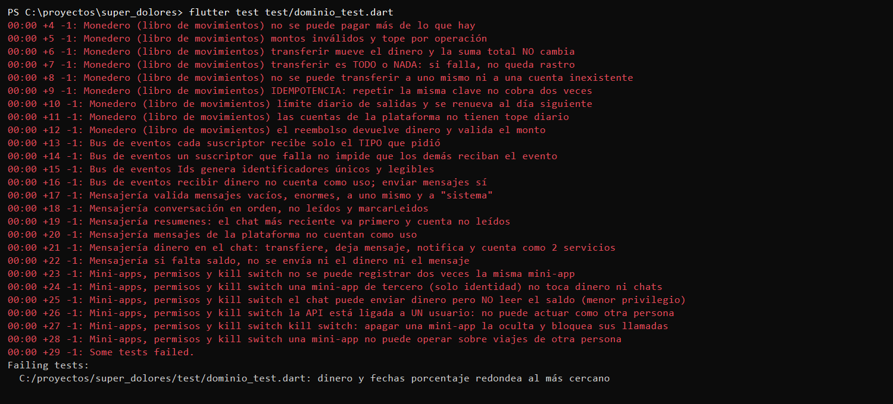

**VERDE** – Se revierte el cambio y las pruebas pasan

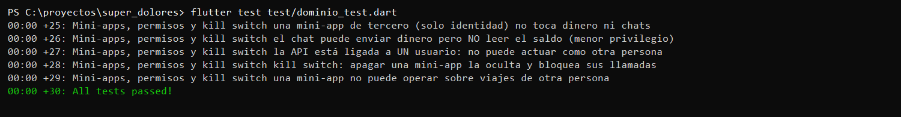

### Ronda 2 – Retención (lealtad, analítica, notificaciones, sugerencias)

**Archivo de pruebas:** `retencion_test.dart`

**Cambio para provocar el fallo:** `lealtad.dart`: el bono semanal por usar 2 servicios se bajó de 50 a 40 puntos.

**ROJO** – La prueba falla

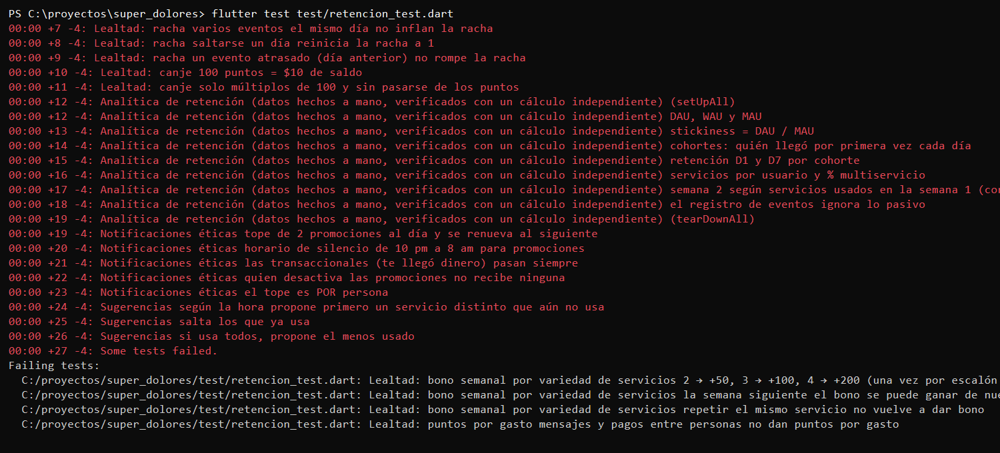

**VERDE** – Se revierte el cambio y las pruebas pasan

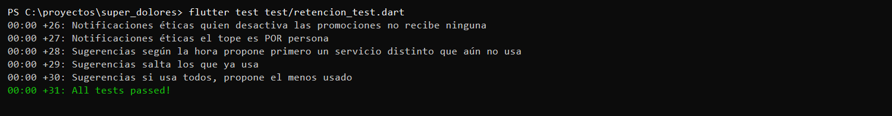

### Ronda 3 – Servicios (comercio y transporte)

**Archivo de pruebas:** `servicios_test.dart`

**Cambio para provocar el fallo:** `comercio.dart`: la comisión de la plataforma se cambió de 5% a 6%.

**ROJO** – La prueba falla

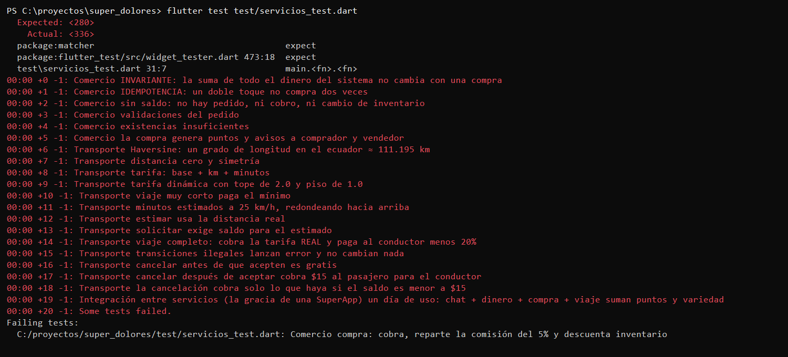

**VERDE** – Se revierte el cambio y las pruebas pasan

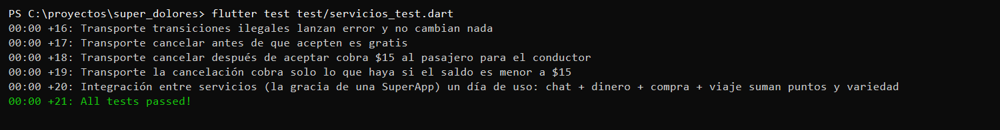

### Ronda 4 – ViewModels

**Archivo de pruebas:** `vms_test.dart`

**Cambio para provocar el fallo:** `inicio_vm.dart`: el contador de mensajes no leídos regresaba siempre 0.

**ROJO** – La prueba falla

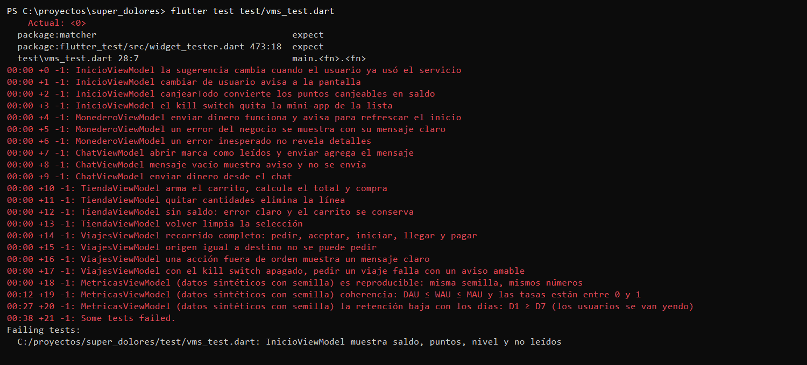

**VERDE** – Se revierte el cambio y las pruebas pasan

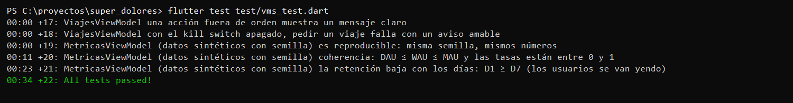

Al final, `flutter test` pasa las 104 pruebas (captura en la sección de evidencia).

## Carpetas

```
lib/
  dominio/dinero.dart
  dominio/excepciones.dart
  dominio/monedero.dart
  dominio/eventos.dart
  dominio/mensajeria.dart
  dominio/comercio.dart
  dominio/transporte.dart
  dominio/mini_app.dart
  dominio/contexto.dart
  dominio/plataforma.dart
  dominio/lealtad.dart
  dominio/analitica.dart
  dominio/notificaciones.dart
  dominio/sugerencias.dart
  presentacion/vm/inicio_vm.dart
  presentacion/vm/monedero_vm.dart
  presentacion/vm/chat_vm.dart
  presentacion/vm/tienda_vm.dart
  presentacion/vm/viajes_vm.dart
  presentacion/vm/metricas_vm.dart
  presentacion/pantallas/widgets.dart
  presentacion/pantallas/pantalla_inicio.dart
  presentacion/pantallas/pantalla_chat.dart
  presentacion/pantallas/pantalla_monedero.dart
  presentacion/pantallas/pantalla_tienda.dart
  presentacion/pantallas/pantalla_viajes.dart
  presentacion/pantallas/pantalla_metricas.dart
  presentacion/pantallas/pantalla_horoscopo.dart
  main.dart
test/
  dominio_test.dart
  retencion_test.dart
  servicios_test.dart
  vms_test.dart
```

## Cómo correrlo

```
flutter pub get
flutter test
flutter run -d chrome
```

En la pantalla de inicio se puede cambiar de persona, abrir el tablero de retención, probar la mini-app de un tercero y apagar Viajes con el kill switch.

## Evidencia

Resultado de `flutter test` (son 104 pruebas en total: 30 del dominio, 31 de retención, 21 de servicios y 22 de los ViewModels):

```
PS C:\proyectos\super_dolores> flutter test
00:37 +104: All tests passed!
```

Captura de la terminal:

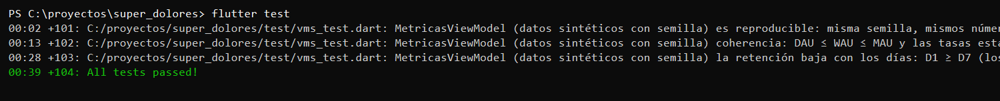

## Evidencia de la app funcionando

Se corrió como app web en Chrome, en la computadora.

| Inicio: saldo de práctica de $1,000 | Chat con Luis y $50 enviados desde el chat |
|---|---|
| 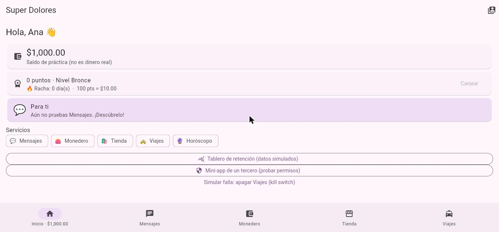 | 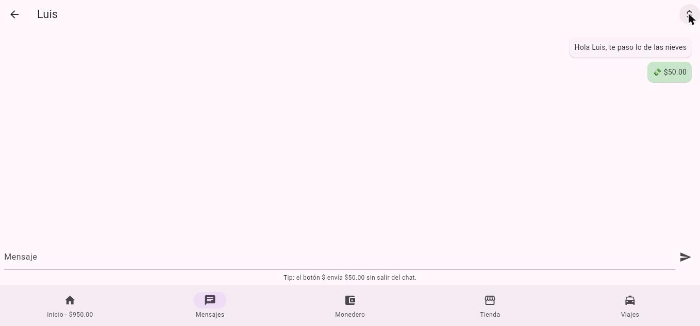 |

| Carrito en Dulces Dolores | Pedido pagado: bajan las existencias y el saldo |
|---|---|
| 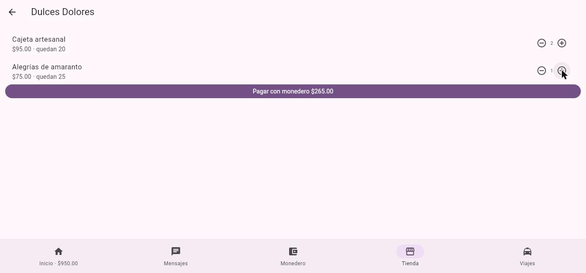 | 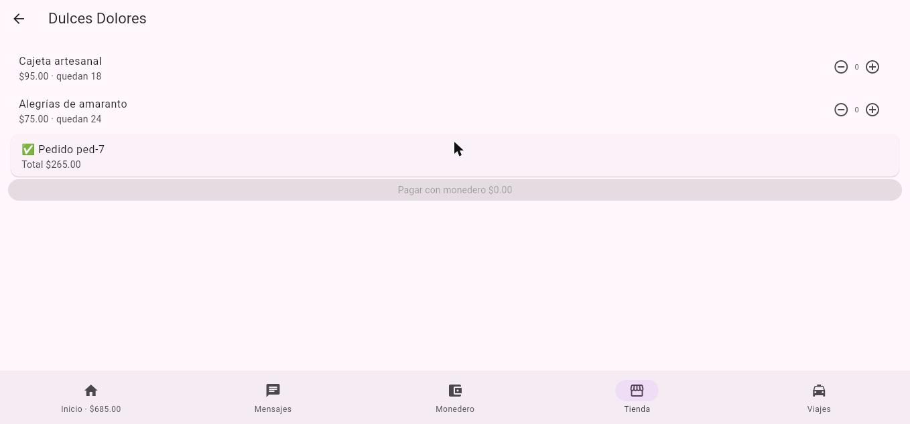 |

| Viaje en curso (Jardín Principal → UTNG) | Viaje finalizado y cobrado |
|---|---|
| 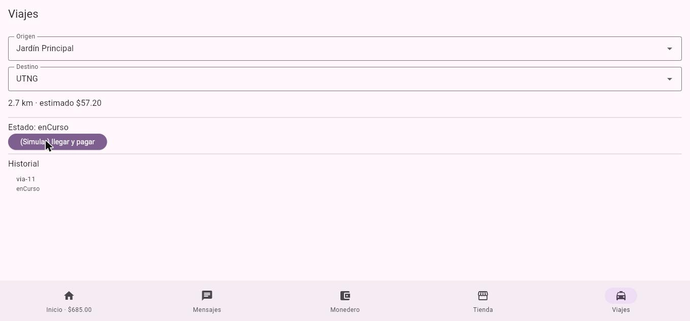 | 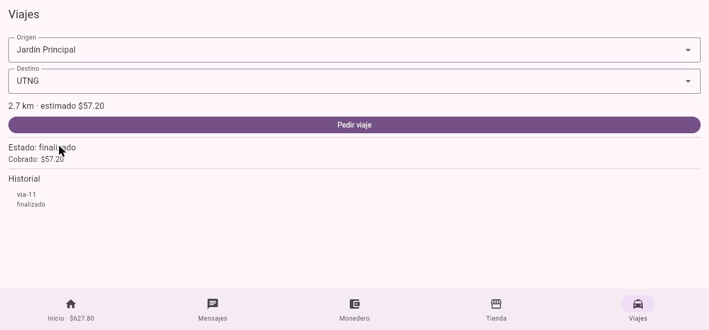 |

| Monedero con su libro de movimientos | Inicio con puntos de lealtad y sugerencia |
|---|---|
| 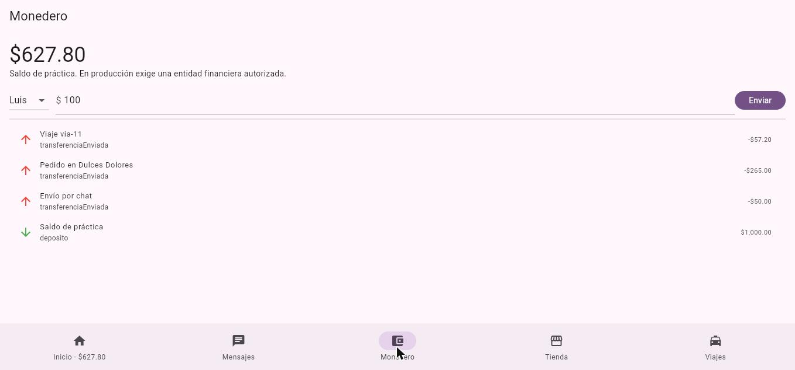 | 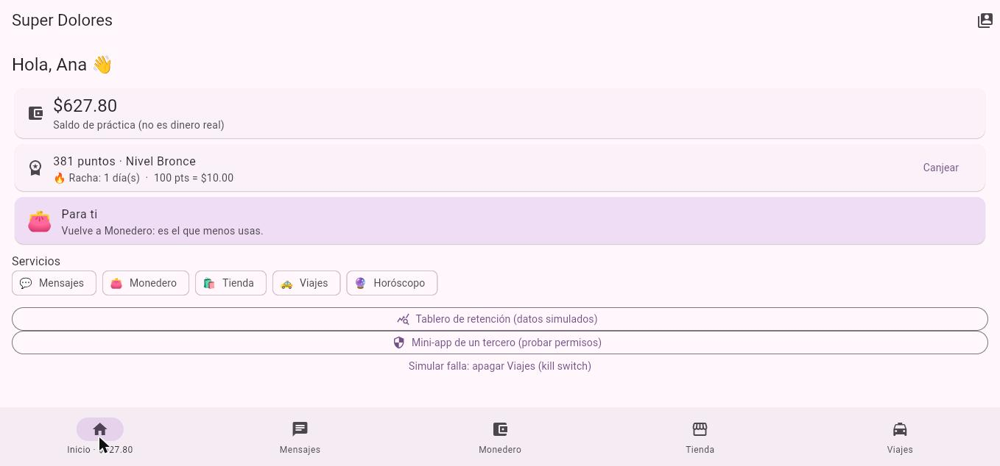 |

| Tablero de retención (datos simulados) | La mini-app de un tercero no puede leer el saldo |
|---|---|
| 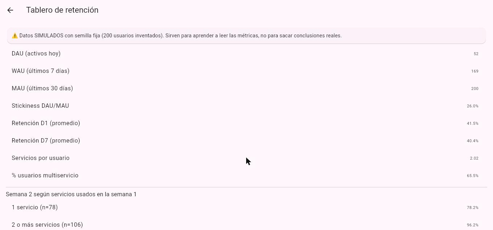 | 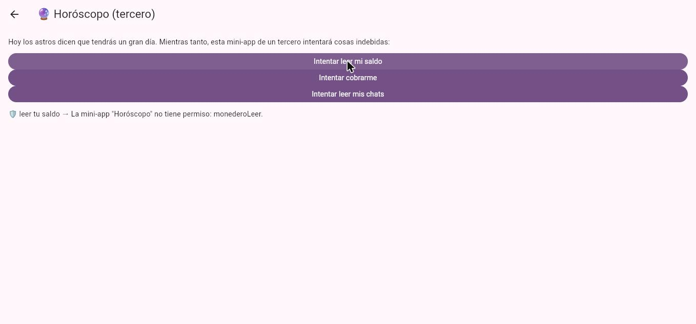 |

Kill switch: al apagar Viajes desaparece de los servicios y de la barra de abajo.

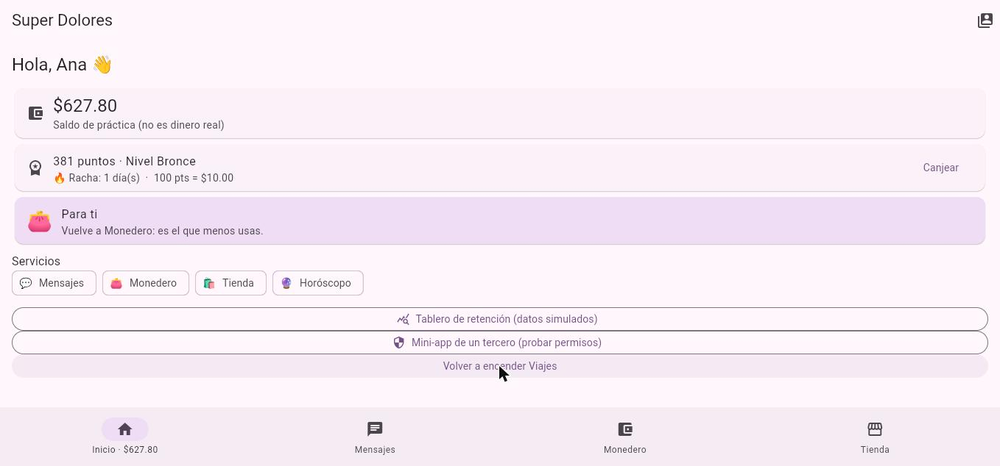
